# Комікс·Lab — вчимо норвезьку через комікси

**Komiks·Lab** — безкоштовний тренажер норвезької мови (bokmål) для дітей і дорослих: намальовані історії A1–B2
з живими норвезькими голосами, переклад при наведенні, тести норвезькою, слова з картинками, граматика,
ігри для класу з QR-кодом і особистий кабінет.

🌐 **Сайт:** https://bilohash.com/comiks/ · 📱 Android (Google Play) · 🪟 Windows (Microsoft Store)

> *English:* Komiks·Lab is a free app for learning Norwegian (Bokmål) through illustrated comics with native-like
> neural voices, hover translations, quizzes in Norwegian, picture vocabulary, grammar and classroom games via QR code.

| | |
|---|---|
| 📚 Коміксів | **212** (A1 41 · A2 84 · B1 66 · B2 21) |
| 💻 Програмування для дітей | **99** коміксів + гра «Robo lærer å kode» |
| 🇬🇧 Курс англійської | **28** історій |
| 📝 Слова за темами | **1133** слів у **54** темах, більшість — з картинками |
| 📐 Граматика | **20** тем з правилами, таблицями й тестами |
| 🌍 Мови інтерфейсу | українська, English, norsk, Deutsch, Polski, Türkçe, Lietuvių, Português (Brasil), العربية |
| 🔊 Озвучення | нейроголоси для кожної репліки, слова, літери й числа |

## Як це виглядає

<table>
<tr><td align="center" width="33%">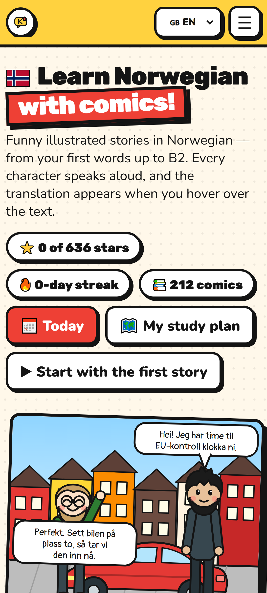<br><sub>Головна</sub></td><td align="center" width="33%">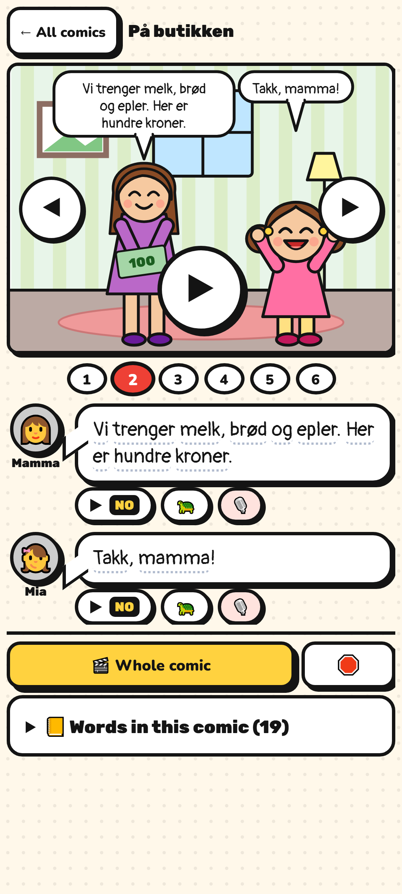<br><sub>Комікс з озвученням</sub></td><td align="center" width="33%">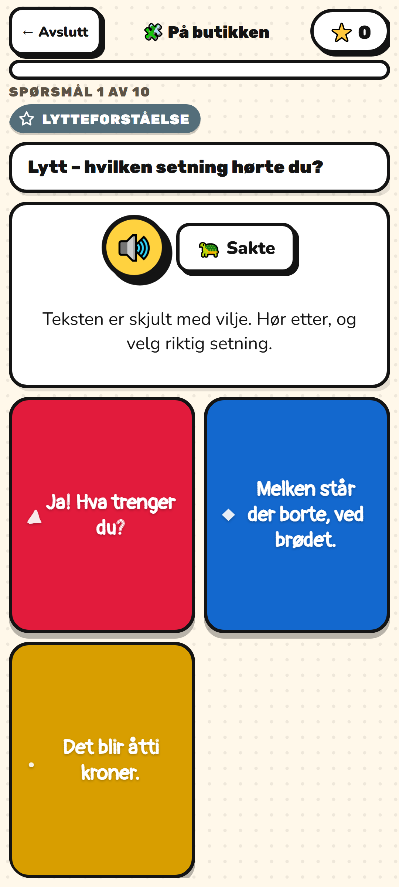<br><sub>Тест норвезькою</sub></td></tr>
<tr><td align="center" width="33%">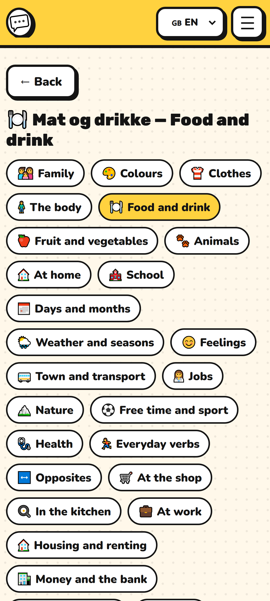<br><sub>Слова за темами</sub></td><td align="center" width="33%">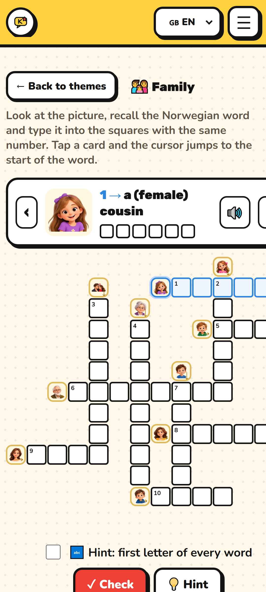<br><sub>Кросворд з картинками</sub></td><td align="center" width="33%">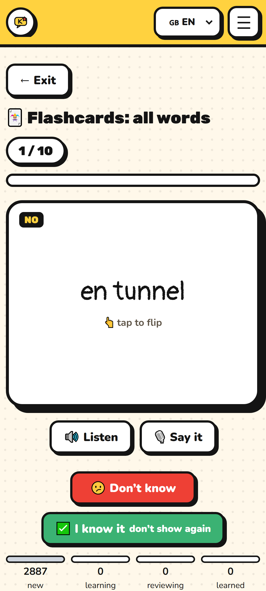<br><sub>Картки</sub></td></tr>
<tr><td align="center" width="33%">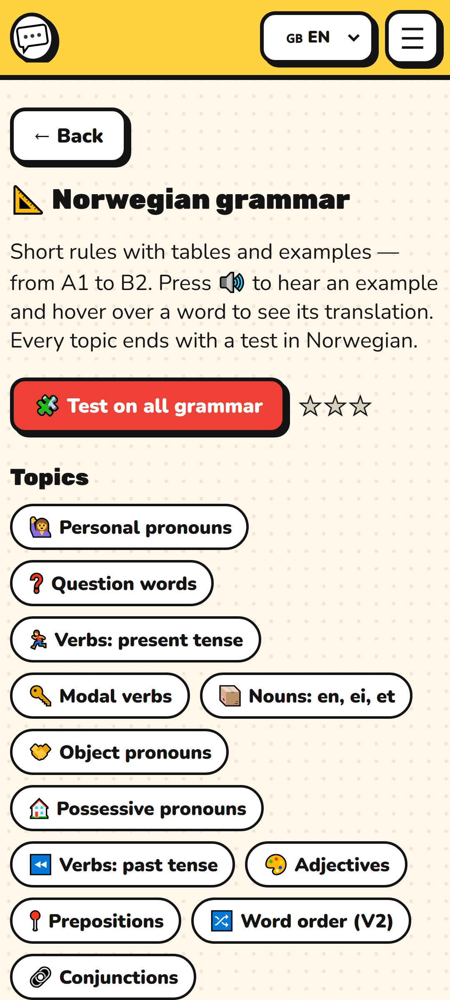<br><sub>Граматика</sub></td><td align="center" width="33%">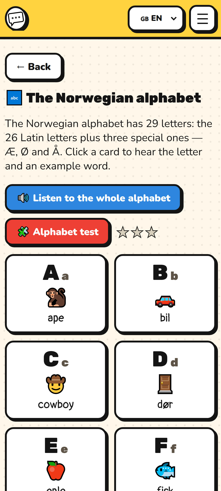<br><sub>Алфавіт</sub></td><td align="center" width="33%">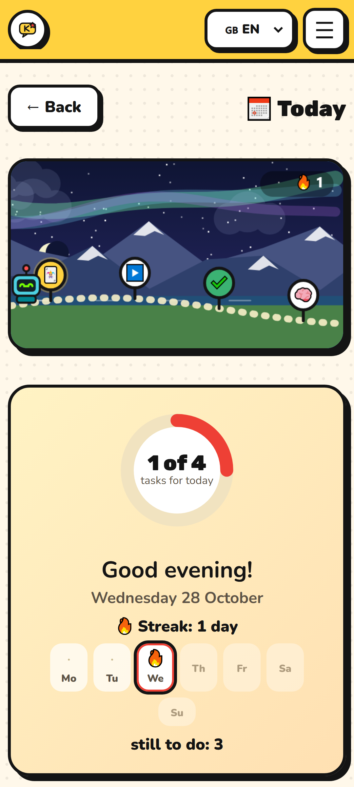<br><sub>Сьогодні</sub></td></tr>
<tr><td align="center" width="33%">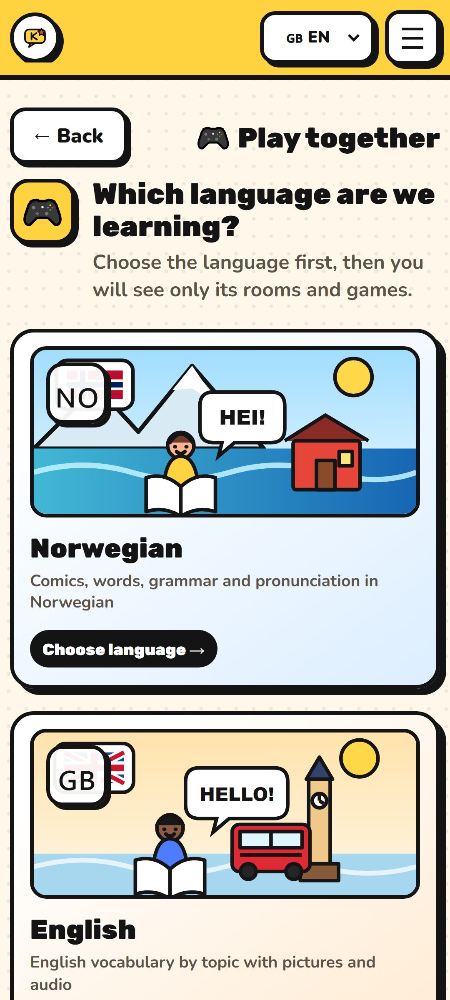<br><sub>Гра разом (QR)</sub></td><td align="center" width="33%">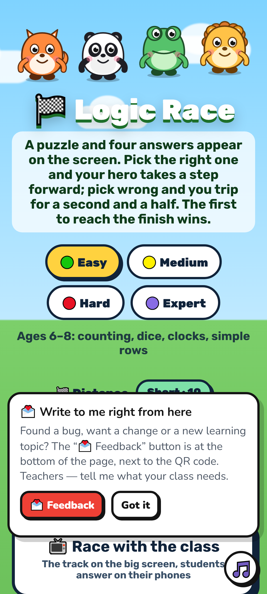<br><sub>Логік-гонка</sub></td><td align="center" width="33%">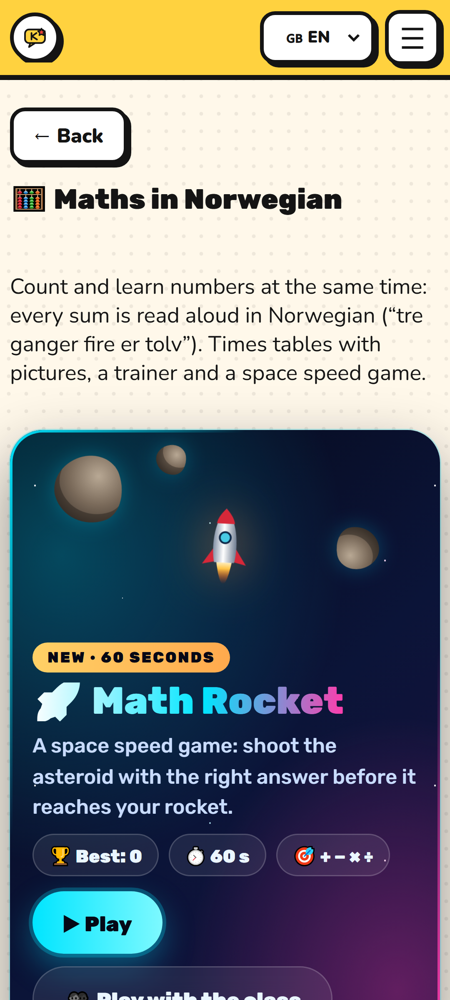<br><sub>Математика</sub></td></tr>
<tr><td align="center" width="33%">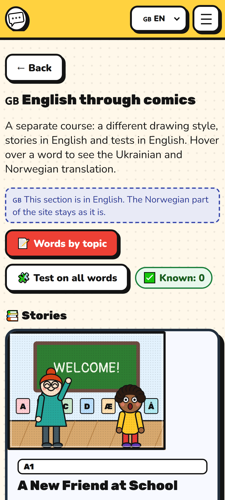<br><sub>Курс англійської</sub></td><td align="center" width="33%">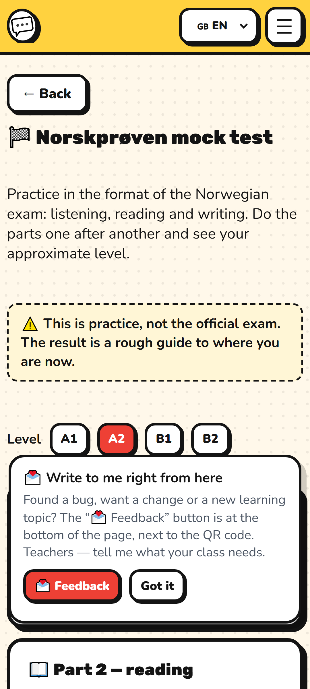<br><sub>Пробний іспит</sub></td><td align="center" width="33%">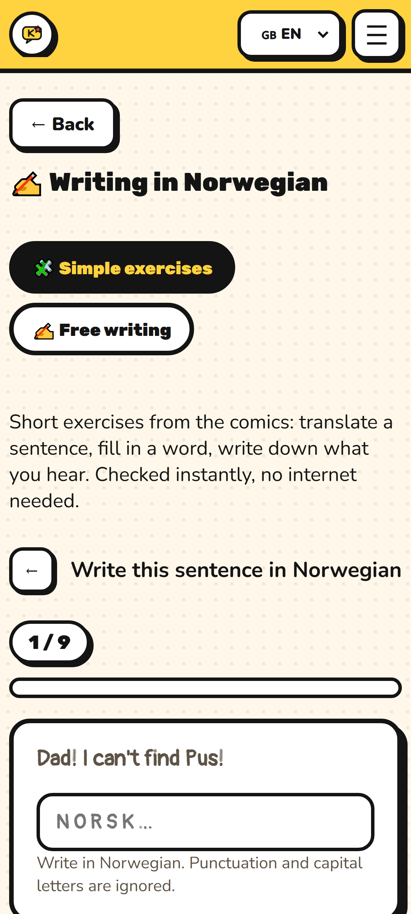<br><sub>Письмо</sub></td></tr>
<tr><td align="center" width="33%">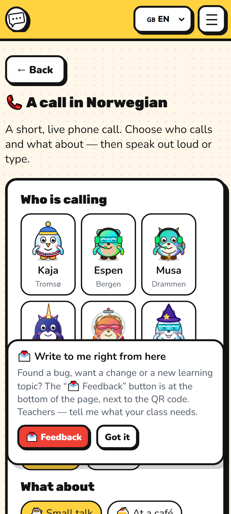<br><sub>Дзвінок</sub></td><td align="center" width="33%">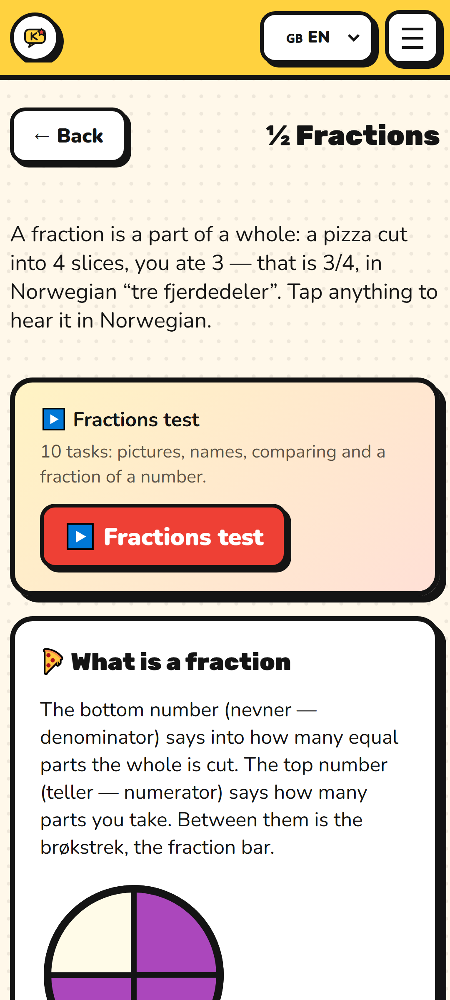<br><sub>Дроби</sub></td><td align="center" width="33%">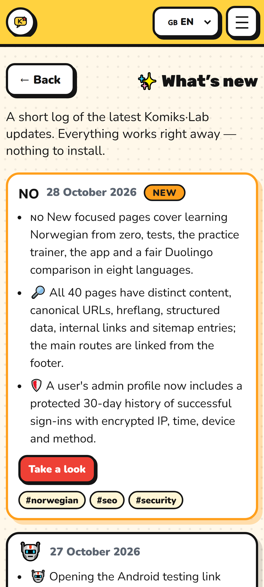<br><sub>Що нового</sub></td></tr>
</table>

## Що є
- **Комікси** за темами: 🏘️ повсякдення, 👨‍👩‍👧 сім’я, 🏫 школа, 🍰 їжа, 🌲 природа, ⛄ дозвілля, 🛒 покупки, 🩺 здоров’я, 💼 робота, 🏠 житло, 🇳🇴 норвезька культура, 📐 граматика в житті, 💻 програмування. Кожна репліка озвучена, переклад — при наведенні.
- **Тести норвезькою** після кожного коміксу, тести рівнів A1–B2, граматика, слова, алфавіт, числа, годинник; складність kids/adults/hard/expert; аналіз помилок і повторення.
- **Слова за темами** з картинками, картки «Знаю / Не знаю», «Пари», **кросворд з картинками**, розумний пошук.
- **Граматика, алфавіт і звуки, числа, годинник, дроби, математика** (таблиця множення, 🚀 Math Rocket).
- **Ігри разом**: вікторина з QR-кодом для класу й родини, Логік-гонка, шахи, Math Rocket «з класом».
- **💻 Програмування для дітей**: комікси про алгоритми, цикли, умови, HTML і гра з рівнями, що зберігає прогрес.
- **Кабінет**: аватар-студія, план навчання, серія днів, значки, друзі, профіль гравця, рейтинг.
- **Сьогодні**: жива сцена дня з завданнями й «Лінквіз дня».
- **Пробний іспит Norskprøven**, письмо з перевіркою, «дзвінок» персонажа.
- **Доступність**: розмір тексту, контраст, шрифт для легкого читання, зупинка анімацій.

## Запуск локально
Чистий HTML/CSS/JS без збірки. Відкрийте `index.html` або запустіть сервер:
```
python -m http.server 8950
```
і відкрийте http://localhost:8950/. Серверна частина (акаунти, стіна, адмінка) — PHP 7.4+ з MySQL або SQLite у `api/`;
налаштування — `api/config.sample.php` → `api/config.php` (у репозиторій не входить).

## Збірка й публікація
```
node tools/check.js        # перевірка коміксів, перекладів, граматики
node tools/build.js        # версія, SEO-сторінки, dist/
node tools/audit-all.js    # підсумкова перевірка
node tools/deploy.js       # заливання dist/ на хостинг
```
Новий комікс — `node tools/new-comic.js <номер> "Norsk tittel" "Українська назва"`, поля — `data/_template.js`,
повна інструкція — `CLAUDE.md`.

## Що в цьому репозиторії немає
- **Озвучення** (`audio/*.mp3`, понад 150 МБ) — генерується `tools/gen_audio.py` (edge-tts).
- **Паролі, ключі API й база даних** — `api/config.php`, `api/config.local.php`, `api/data/`, дампи SQL.

## ✨ Що нового

### 🇧🇷 28.10.2026 · [відкрити](https://bilohash.com/comiks/#/settings)
- 🇧🇷 Нова мова — бразильська португальська. Інтерфейс, усі 212 коміксів (репліки й словнички), понад 1100 слів за темами, граматика, підказки в тестах, «Що нового», листи, політика приватності й пошукові сторінки. Обрати — у шапці або в налаштуваннях; у підказці до коміксів португальську можна ввімкнути поруч з іншими мовами.
- 🔌 Друзі онлайн більше не «ламають» браузер: після кількох годин на сайті з’являлося «Cannot create so many PeerConnections», бо кожні 25 секунд відкривалося нове з’єднання з кожним офлайн-другом. Тепер старе закривається, а до недоступного друга сайт стукає раз на 2 хвилини.

### 🇳🇴 28.10.2026 · [відкрити](https://bilohash.com/comiks/#/plan)
- 🇳🇴 Додано окремі сторінки для вивчення норвезької з нуля, тестів, тренажера, застосунку та чесного порівняння з Duolingo — вісьмома мовами.
- 🔎 Усі 40 сторінок мають власний зміст, canonical, hreflang, мікророзмітку, внутрішні посилання й записані в карту сайту. Посилання на головні розділи з’явилися у футері.
- 🛡️ В адмін-профілі користувача тепер є захищена 30-денна історія успішних входів: зашифрована IP-адреса, час, пристрій і спосіб входу.

### 🤖 27.10.2026 · [відкрити](https://bilohash.com/comiks/#/install)
- 🤖 Перед переходом до тестування Android-застосунку тепер відкривається коротка форма з обов’язковим email і перевіркою від спаму.
- 📬 Запити потрапляють в окрему категорію «Android» у відгуках адміністратора. Після успішної перевірки користувач отримує кнопку з посиланням для тесту.

### ⚡ 27.10.2026 · [відкрити](https://bilohash.com/comiks/#/today)
- ⚡ Лінквіз дня тепер не закінчується після першої п’ятірки: натисни «Наступні 5 слів» і проходь нові набори без обмежень.
- 🔁 Після результату можна окремо повторити поточні слова. У межах циклу слова не дублюються, а на телефоні кнопки розміщені вертикально.

### 🏡 27.10.2026 · [відкрити](https://bilohash.com/comiks/#/read/p299/0)
- 🏡 Три нові сюжетні A2-комікси: пошук житла й бюджет, вибір куртки в магазині та ранок, коли легко запізнитися.
- 🧩 Додано 24 авторські тести на розуміння тексту й новий граматичний тренажер: derfor, likevel, dessuten, ettersom, på grunn av, for å та i motsetning til.

### 🎒 27.10.2026 · [відкрити](https://bilohash.com/comiks/#/read/p291/0)
- 🎒 Вісім нових сюжетних коміксів про присвійні слова: min/mi/mitt/mine, din/di/ditt/dine, vår/vårt/våre, hans/hennes/deres та sin/si/sitt/sine.
- 📐 У граматиці з’явилися три окремі тренування: «мій і твій», «наш, його, її та їхній» і порядок слів bilen min / min bil. У кожному коміксі — 6 сцен, 4 нові тести та словник трьома мовами.
- 🗂️ Адмінка матеріалів тепер читає повний каталог, тому показує всі комікси, включно із серіями, створеними генераторами.

### 🕵️ 26.10.2026 · [відкрити](https://bilohash.com/comiks/#/read/p283/0)
- 🕵️ Новий рівень «Хакери та кіберзахист»: 8 окремих коміксів пояснюють, хто такі хакери, чим законне тестування відрізняється від злочину, як працюють соціальна інженерія, викрадення акаунтів і персональних даних.
- 🛡️ Окремі історії розповідають про цифровий шантаж, віруси-вимагачі, шкідливі застосунки та відновлення після атаки. У кожному коміксі — 6 сцен, 4 тести й словник трьома мовами.

### 🚨 26.10.2026 · [відкрити](https://bilohash.com/comiks/#/read/p275/0)
- 🚨 Вісім нових практичних коміксів про екстрені ситуації в Норвегії: пожежа, швидка допомога, поліція, ДТП, отруєння, непритомність, небезпека вдома та серцево-легенева реанімація.
- ☎️ Діти й дорослі тренуються правильно обирати 110, 112, 113, 02800, 116 117, 22 59 13 00 та 116 006. У кожному коміксі — 6 сцен, 4 тести, словник і перевірені офіційні рекомендації.

### 📘 26.10.2026 · [відкрити](https://bilohash.com/comiks/#/read/p274/0)
- 📘 Новий комікс «SIS, депортація та наступні кроки» пояснює різницю між обов’язком виїхати, відмовою у в’їзді, видворенням, забороною на в’їзд і примусовим вивезенням поліцією.
- ⚖️ В окремих сценах показано права на доступ до власних даних SIS, виправлення помилок, видалення незаконного запису та оскарження рішення. Інформацію перевірено за матеріалами UDI, поліції Норвегії та Єврокомісії.

### 🎓 26.10.2026 · [відкрити](https://bilohash.com/comiks/#/koding)
- 💻 До курсу програмування додано ще 50 навчальних коміксів. Тепер у «Моїй кодоподорожі» 91 урок у 11 напрямах: основи, HTML і веб, розробка ігор, Blender, Unity, бази даних та п’ять напрямів безпеки.
- 🎓 У граматиці з’явився особистий кабінет: пройдені тести, найкращий і останній бал, кількість спроб та окремий список тем, які варто повторити.

### 💻 26.10.2026 · [відкрити](https://bilohash.com/comiks/#/koding)
- 💻 На головній з’явилася новинка «Програмування для дітей»: базовий курс із 41 коміксу в 11 напрямах, коротке пояснення, прогрес профілю, значки та одна кнопка «Спробувати курс».
- 🇳🇴🇬🇧 На сторінці «Гра разом» вибір мови став наочним: норвезька й англійська мають окремі навчальні ілюстрації з прапорами. На телефоні картки складаються вертикально, на комп’ютері стоять поруч.

### 🛡️ 26.10.2026 · [відкрити](https://bilohash.com/comiks/#/koding)
- 🛡️ 20 нових навчальних коміксів про безпеку для дітей: по 4 уроки в категоріях «Безпека в житті», «Безпека онлайн», «Розпізнай шахрайство», «Захист пристроїв» і «Безпечне програмування». У кожному — 6 ілюстрованих сцен, тест і словник норвезькою, українською та англійською.
- 🚨 Діти тренуються діяти при зустрічі з незнайомцем, коли загубилися, під час дзвінка 112, а також розпізнавати фішинг, небезпечні QR-коди, фальшиві призи, клоновані голоси й підроблені профілі.
- 🔐 Окремі комікси просто пояснюють CAPTCHA, серверну валідацію, HTTPS і безпечне хешування паролів. У «Моїй кодоподорожі» тепер 11 категорій, а їх вибір на телефоні став компактним і зручним.

### 🎮 25.10.2026 · [відкрити](https://bilohash.com/comiks/#/game)
- 🛠️ «Гра разом»: посилання на кімнату з темою (наприклад, «Mat og drikke» з QR на сторінці слів) тепер завжди відкриває кімнату саме з цією темою — раніше могла лишитися попередня кімната з іншою темою.
- 🧮 Кімната з математикою знову дає повну гру: 10 різних прикладів замість одного.
- 📱 Верхній блок «Гри разом» на телефоні більше не вилазить за край екрана.

### 🧩 25.10.2026 · [відкрити](https://bilohash.com/comiks/#/cross)
- 🧩 Кросворд тепер із картинками, як у справжніх дитячих кросвордах: мініатюра стоїть просто в клітинці перед словом, а над сіткою — велика картинка слова, яке зараз пишеш (з 🔊 і кнопками ‹ ›). Картки підказок — з малюнком, номером, стрілкою і клітинками за кількістю літер.
- 🔤 Нова підказка «перша літера в кожному слові» — вмикається галочкою й запам'ятовується. Можна друкувати слово повністю, разом із відкритою літерою.

### 🌄 25.10.2026 · [відкрити](https://bilohash.com/comiks/#/today)
- 🌄 «Сьогодні» ожило: жива сцена фіорду в кольорах поточної години — ранок, день, вечір, ніч із північним сяйвом, взимку сніг. Робо йде стежкою від завдання до завдання, натисни прапорець — відкриється завдання. Плюс «⚡ Лінквіз дня»: 5 слів із картинками.
- 🎮 Нова «Гра разом»: великий екран із QR і гравцями, «Почни за один натиск» (слова з картинками, граматика, числа, годинник, алфавіт, математика) та останні ігри на цьому пристрої.

### 💻 25.10.2026 · [відкрити](https://bilohash.com/comiks/#/koding)
- 💻 Оновлена сторінка «Програмування»: картка гри з твоїм прогресом, «Моя кодоподорож» — 9 коміксів кроками (прочитано / тест) — і 10 значків: від «Перша програма» до «Майстер коду». Рівень гравця росте від «Новачок» до «Майстер коду».
- 🏆 У грі «Robo вчиться кодити» новий розділ «Майстер-проба»: звивистий лабіринт, де цикли й функція працюють разом, і останній баг. Тепер 17 рівнів.
- 🖼️ Ще сотня картинок для слів: абстрактні поняття, ділова мова, щоденні фрази, розмова, довкілля, норвезька культура, люди й характер.

### 🤖 25.10.2026 · [відкрити](https://bilohash.com/comiks/#/koding/spill)
- 🤖 Нова гра «Robo вчиться кодити»: складай програму з блоків — кроки, цикли «gjenta», власна функція F — і Робо виконає її на полі. 15 рівнів у 4 розділах: команди, цикли, функції, пошук помилок. Зірки за найкоротшу програму, прогрес зберігається в акаунті.
- 🖼️ Картинки тепер у темах «Дні та місяці», «Життя на природі», а всі 24 тварини отримали нові малюнки.

### 🎮 25.10.2026 · [відкрити](https://bilohash.com/comiks/#/game)
- 🎮 «Гра класом або разом» тепер нагорі «Гри разом» і сторінок «Слова»: обери тему — одразу кімната з QR-кодом. Теми з картинками позначені 🖼️, їх можна запустити одним натиском.
- 📱 Гра разом, Логік-гонка, Math Rocket з класом, шахи й друзі тепер працюють і у вбудованих браузерах Telegram, Instagram, Facebook та на iPhone — раніше там з’являлося «Цей браузер не вміє прямих з’єднань».
- 🖼️ Нові картинки замість смайлів: «Кольори», «Погода й пори року», «Школа». Тепер картинки мають 12 тем, а слова з кількома значеннями отримують правильну: «is» — морозиво в «Їжі» і лід у «Погоді».
- 🔍 Пошук у шапці (🔍 або клавіша «/») знаходить слова, комікси, репліки, граматику й розділи будь-якою мовою — навіть із помилками.

### 🔍 25.10.2026 · [відкрити](https://bilohash.com/comiks/#/search)
- 🔍 Розумний пошук по всьому сайту: слова, комікси й репліки, граматика, розділи. Пишіть норвезькою, українською чи англійською — пошук прощає помилки («hamer» знайде hammer) і розуміє слова без æ/ø/å. Кнопка 🔍 у шапці або клавіша «/».
- 📝 На сторінці «Слова» — швидкий пошук слова з картинкою й озвученням.
- 🖼️ Нові картинки замість смайлів у темах «Сім’я», «Одяг», «Тіло», «Їжа», «Фрукти й овочі», «Тварини», «Дім», «Школа», «Погода» й «Кольори».

### 🔨 25.10.2026 · [відкрити](https://bilohash.com/comiks/#/words/verktoy)
- 🔨 Нова тема слів «Будівельні інструменти» — 20 справжніх фото: молоток, шуруповерт, перфоратор, болгарка, рулетка, рівень і ще. Тест «Hva er dette?» показує фото, а слова озвучено норвезькою.
- 🎮 Кімната одним натиском: на сторінці будь-якої теми слів є кнопка «Гра разом (QR)» — учні сканують код і відповідають з телефонів. Фото інструментів видно й на телефонах.
- 🌐 Новий комікс «Сайт про Пуса: основи HTML» і тест, де за HTML-кодом треба вибрати, як виглядатиме сторінка.
- 🗺️ Оновлена карта сайту: розділ «Програмування», усі теми слів за рівнями й усі комікси.

### 💻 25.10.2026 · [відкрити](https://bilohash.com/comiks/#/koding)
- 💻 Нова категорія «Програмування» для дітей: 8 коміксів із роботом Робо — що таке команда й програма, алгоритм, цикл, умова «якщо», змінна, пошук помилок, мови програмування й моделювання.
- 🤖 Новий стиль малюнків: комп’ютерний клас, рамка вікна програми, а робот говорить «терміналом» — зеленими літерами.
- 🧩 Нові типи тестів: керуй роботом на полі, скажи, що виведе програма (псевдокод і Python), розстав кроки алгоритму, знайди помилку й дізнайся, для чого Scratch, Python, JavaScript, Swift, Kotlin і C#.
- 📖 Сторінка «Програмування» з поясненнями для батьків і вчителів. Усе норвезькою з перекладом при наведенні.

### 🎮 24.10.2026 · [відкрити](https://bilohash.com/comiks/#/account/learn)
- 🇬🇧 20 нових англійських історій (A1–B1) з озвученням і тестами — тепер їх 28. Кожна вчить одну граматичну тему, а новий «План англійської» веде від «I am» до пасиву: 22 теми з правилами й прикладами.
- 🔀 «Що я вчу»: у налаштуваннях і кабінеті можна обрати норвезьку чи англійську — головна відкриє потрібний курс.
- 📅 Оновлена сторінка «Сьогодні»: кільце прогресу дня, серія за тиждень і «Слово дня», яке можна перевернути й послухати.
- 🎮 Моє лобі: у кабінеті з’явився твій постійний QR-код. Друзі сканують його й одразу потрапляють у твою кімнату, а ти обираєш тест на всіх, коли всі зібралися. Кожен відповідає на своєму пристрої — хто швидше й точніше, той вище в рейтингу.
- 📊 Новий дашборд навчання в кабінеті: тести, точність, дні навчання, вивчені слова й виправлені помилки — з порівнянням із попереднім періодом, графіками, ефективністю за розділами й порадами, що робити далі.
- 🔥 У плані навчання — календар активності за рік, як на GitHub, а ще твій рівень і серії днів поспіль.
- 📈 Нова сторінка «Статистика» (посилання у футері): що додалося на сайті цього місяця й як це порівняно з минулим.
- 🔔 Сповіщення показують спершу 10 свіжих подій, а решту — кнопкою «Показати ще».

### 📣 24.10.2026 · [відкрити](https://bilohash.com/comiks/#/tests)
- 📣 Поділися успіхом: після тесту з’являються кнопки Facebook, Messenger, Telegram, WhatsApp, Viber, X і e-mail з готовим текстом про твій результат, а поруч — «Відгук про тест».
- 🛡 Безпечніша спільнота: дописи й повідомлення з ознаками небезпеки для дітей, чужими контактами чи лайкою тепер помічаються одразу й прибираються швидше. Поскаржитися на повідомлення можна кнопкою 🚩.
- 📲 На телефоні код друга стоїть одразу під QR-кодом, а значки Google Play і Microsoft Store — акуратно в один ряд.
- ✉️ Листи від Комікс·Lab отримали новий вигляд і посилання на застосунок для Android і Windows.

### 📚 24.10.2026 · [відкрити](https://bilohash.com/comiks/#/)
- 📚 Чотири нові комікси: «En travel morgen» (A1), «Fotballtrening» (A2), «Brannøvelse på jobben» (B1) і «Valg og demokrati i Norge» (B2) — з озвученням, словником і тестами.
- 🧠 Розумні повторення: помилка зникає з журналу, лише коли ти правильно відповіси на неї тричі в різні дні. У картках — «Не знаю», «Ще повторити» і «✅ Знаю»: вивчене слово більше не показується. «Мій аналіз» показує, що повторити сьогодні, динаміку тестів, де ти помиляєшся і на якому етапі кожне слово.
- ½ Дроби в математиці: що таке чисельник і знаменник, конструктор дробів на піці й смужці, назви норвезькою («tre fjerdedeler»), однакові дроби й частина від числа. І окремий тест «Дроби» на 10 завдань — усе з озвученням.
- 👤 Кабінет і профіль гравця тепер в одному місці з вкладками: Профіль, Досягнення, Навчання й Акаунт. Є кнопка «Поділитися», а видалити акаунт можна й без пароля — кодом на пошту. Google можна відв’язати в налаштуваннях.
- 😊 Емоції в повідомленнях: панель емодзі, реакції на повідомлення друга й великі анімовані емодзі.
- ♿ Спеціальні можливості переїхали в Налаштування й відкриваються окремим вікном.
- 🎁 Подарунки друзям — безкоштовно: на сторінці «Друзі» обери річ і побажання норвезькою. Сердечка, конфеті, квітковий вінок, бант, кулон «BFF» і цукерковий колір можна лише отримати від друга.
- ✨ Аватари стали крутішими: новий розділ «Ефекти» (іскорки, музика, зоряна орбіта, веселкове сяйво, вогняна аура, північне сяйво) і рамки рідкості — від звичайних до легендарних.
- 👥 На головній — твій QR «Стати друзями»: друг сканує телефоном і одразу додається. Поруч — значки Google Play і Microsoft Store.

### 🔑 23.10.2026 · [відкрити](https://bilohash.com/comiks/#/login)
- 🔑 Вхід через Google: одна кнопка на сторінках входу й реєстрації. Новий акаунт створюється одразу, а наявний із підтвердженою поштою Gmail приєднується сам. Якщо ввімкнено двофакторний вхід, код питається, як і раніше.
- Три нові пригоди з аватарами: Детектив пам’яті, Майстер візерунків і Мисливець за деталями. Тренуйся з ботами або створи кімнату й запроси клас за QR-кодом.
- На головній — короткий блок «Створи героя» та журнал у каруселі. Додано окремі інструкції завантаження для Windows і Android.
- Поліпшено підтвердження пошти: повторний запит більше не скасовує попередній лист.

### 🧭 22.10.2026 · [відкрити](https://bilohash.com/comiks/#/)
- Головна стала компактнішою: Алфавіт, Слова, План навчання й Тести — одразу перед очима; інші розділи — у «Усі розділи».
- Кнопка «Відкрити кімнату» веде до вибору налаштувань гри. Додаткові ігри, герой і друзі та матеріали Журналу Комікс·Lab розгортаються натисканням.

### 📱 21.10.2026 · [відкрити](https://bilohash.com/comiks/#/install)
- 📱 Learning Norwegian для Android — у Google Play. Відкривайте комікси, слухайте норвезьку та навчайтеся зі своїм акаунтом. Для онлайн-функцій потрібен інтернет; доступність встановлення залежить від країни й етапу випуску.
- ✨ Компактне стартове вікно з вибором мови, випадкові комікси на головній та кнопка озвучення кадру.

### 🔁 07.10.2026 · [відкрити](https://bilohash.com/comiks/#/english)
- 🔁 У курсі англійської зʼявилася власна робота над помилками: слова, у яких ви схибили, повертаються окремим тестом. Вони не змішуються з норвезькими — у «Парах» і кросворді, як і раніше, лише норвезькі слова.

### 🌍 04.10.2026 · [відкрити](https://bilohash.com/comiks/#/settings)
- 🌍 Увесь застосунок тепер говорить вашою мовою: кнопки, пояснення, ігри та рейтинг гравців — 1093 написи, які німецькою, польською, турецькою, литовською й почасти арабською досі лишалися англійськими.
- ⚡ Мова перемикається одразу, без перезавантаження сторінки, і кожна вантажиться окремо — тож застосунок не став важчим для решти.
- 📧 Листи від сайту — підтвердження пошти, код для входу, вітання — тепер приходять вашою мовою, а не англійською.
- 📐 Граматика теж говорить вашою мовою: правила, таблиці форм і кожне речення-приклад.
- 📜 Політику приватності написано всіма вісьмома мовами, а в курсі англійської підказки під реплікою й словом тепер вашою мовою, а не українською.
- 🇬🇧 Курс англійської тепер читається так само, як норвезькі комікси: на телефоні — один екран без гортання, керування на самому малюнку, і тест виглядає так само.
- 🇬🇧 У тестах курсу англійської наступне питання тепер приходить саме, а голос хвалить англійською — дванадцять різних фраз замість чотирьох. І обкладинки історій більше не лишають білої смуги на телефоні.
- 📐 Чотири нові історії про кількість і розмір: mye чи mange, stor чи liten, litt–lite–få, større і størst. Вони лежать в окремій категорії «Граматика в житті» — з озвученням і тестами, як усі інші комікси.
- 👋 Після створення акаунта коротке знайомство розповідає, що тут є, дає обрати мову й попереджає: перші 100 користувачів лишають повний доступ назавжди.
- 📱 Оновлено застосунки: Android і Windows, онлайн і офлайн — зі свіжим вмістом і всіма вісьмома мовами.

### 🌍 03.10.2026 · [відкрити](https://bilohash.com/comiks/#/settings)
- 🌍 Застосунок говорить вісьмома мовами по-справжньому: кожну репліку, кожне слово й опис кожного коміксу тепер перекладено англійською, українською, норвезькою, арабською, німецькою, польською, турецькою та литовською. Досі німецькою чи польською було перекладене лише кожне третє слово, а цілі речення — майже ніде.
- 🔎 Пошук тепер знаходить комікси будь-якою з цих мов: у кожного комікса й у сторінки тестів є своя адреса кожною мовою — із заголовком, описом і діалогом тією самою мовою.
- 🤖 Нові переклади зробив ШІ. Якщо десь звучить дивно — напишіть нам, виправимо.

### 🔀 03.10.2026 · [відкрити](https://bilohash.com/comiks/#/tests)
- 📖 Чотири нові комікси: «Я захворів» і «У мене вдома» (A1), «Знижки й картка покупця» (A2), «Алергія в ресторані» (B1). Усі репліки озвучені норвезькою — 295 нових записів.
- 🔤 Шість нових тем у словах: алергія та склад їжі, знижки й ціни, кімнати вдома, коли ти хворий, прибирання й дрібний ремонт, сусіди. Разом +124 слова.
- 🔀 Новий тренажер «Порядок слів»: складаєте речення зі слів — саме там, де норвезька ламає найбільше людей. Дієслово другим, а після обставини підмет і дієслово міняються місцями. Половина завдань — саме такі перевернуті речення, узяті з коміксів.
- 📱 Читання на телефоні тепер в один екран, без гортання. Керування переїхало на сам малюнок: ▶ унизу кадру озвучує репліки, стрілки по краях гортають кадри, а номери сторінок — під картинкою.
- 🔤 Переклад репліки з’являється просто під реченням, а не спливаючою хмаркою згори: раніше в першого рядка її було видно наполовину. І дотик по слову знову показує переклад — на телефоні він міг не спрацьовувати зовсім.
- 📖 Дочитали історію — внизу одразу «До тесту» і «Далі»: наступний комікс добирається за рівнем і темою того, який ви щойно прочитали. А на головній з’явилася кнопка з назвою наступної історії, щоб не шукати її в списку з вісімдесяти одного пункту.
- 🙈 Хто ввійшов — прочитане ховається у фільтр «пройдені», щоб у списку лишалося тільки нове. Повернути його можна одним дотиком.
- 🔑 Без акаунта тепер можна пройти один тест. Далі потрібен вхід — зате все зроблене переноситься в акаунт: прочитані історії, зірки, серія днів і слова з карток. Читати комікси без акаунта можна скільки завгодно.

### 🔐 03.10.2026 · [відкрити](https://bilohash.com/comiks/#/account)
- 🔐 У налаштуваннях з’явилася двофакторна авторизація: під час входу сайт додатково питає шестизначний код із застосунку-автентифікатора. Підійде будь-який — Google Authenticator, Authy, 2FAS, Aegis.
- 🔑 Одразу після ввімкнення видаємо вісім резервних кодів. Збережіть їх: кожен працює один раз і це єдиний спосіб зайти, якщо телефон загубиться. Повторно ми їх не покажемо — у базі лежать лише згортки.
- 🔒 Двофакторна діє на всіх трьох способах входу: за паролем, за кодом із пошти й за посиланням. Вимкнути можна тільки з підтвердженням кодом.
- 📖 Комікс тепер гортається як журнал: кадр відкидається вбік, і видно, у який бік ви рухаєтесь — уперед чи назад. Якщо в системі ввімкнено «менше руху», анімації не буде.
- 🖼️ Рамку кадру зробили тоншою, тож на телефоні зображення стало помітно більшим, а гортати сторінку під час читання не доводиться.

### 🪟 02.10.2026 · [відкрити](https://bilohash.com/comiks/#/install)
- 🪟 З’явився інсталятор для Windows (.exe): ставить ярлик на робочий стіл і в меню «Пуск», застосунок відкривається окремим вікном без адресного рядка.
- 📦 Два варіанти: легкий на 2 МБ — ярлик на сайт, і повний на 120 МБ — усі комікси й озвучення лягають на диск і працюють взагалі без інтернету.
- 🔓 Інсталятор не просить прав адміністратора: ставить усе в теку вашого користувача й видаляється як звичайна програма.
- ⏭️ У тестах більше не треба тиснути «Далі»: після відповіді тест іде далі сам — за секунду-дві, якщо відповідь правильна, і за чотири, якщо треба прочитати правильну.
- 👆 Смужка показує, скільки лишилось, а дотик до екрана зупиняє відлік — якщо хочеться подумати довше або переслухати. Вимикається в налаштуваннях.

### 🧩 02.10.2026 · [відкрити](https://bilohash.com/comiks/#/cross)
- 🧩 Нова гра «Кросворд»: слова з теми перетинаються в сітці, підказка — переклад і емодзі. Тут мало впізнати слово — його треба згадати й написати по літерах, а саме це закріплює å, ø, æ й подвоєні приголосні.
- 💡 Є підказка на одну літеру й «показати відповідь», якщо зовсім застрягли. Сорок сім тем на вибір.
- 💬 Новий тип питання в тестах — «Що відповісти?»: чуєте репліку й обираєте відповідь із того самого коміксу. Решта питань перевіряють окреме речення, а це — чи тримаєте нитку розмови.
- 🧩 І ще один — «Який прийменник?»: у реченні ховається på, i, til, fra чи med. Варіанти завжди прийменники, тож на око не вгадаєш.
- 📱 «Правильно / Далі» більше не дописується під варіантами, а виїжджає шторкою знизу. Раніше через нього сторінка ставала вищою за екран і доводилося гортати; тепер питання лишається на місці, а кнопка «Далі» — під великим пальцем.

### 📖 02.10.2026 · [відкрити](https://bilohash.com/comiks/#/install)
- 📖 Шість нових коміксів: «Купити одяг» (A1), «На вокзалі» (A2), «Повідомити про переїзд» (B1), «Трудовий договір» (B2) і дві частини «Питання про батьківщину» (B1).
- 🎯 «Питання про батьківщину» — це той самий блок, який питають на усному Norskprøven: столиця, населення, сусіди, мова, валюта, їжа, клімат, свята. Відповіді короткі, щоб їх можна було переробити під свою країну.
- 🔊 Усі нові репліки озвучені норвезькою — 328 нових записів.
- 📦 На сторінці «Встановити» з’явився файл APK для Android: легкий (16 МБ, з акаунтом) і повний (157 МБ, працює без інтернету взагалі). Google Play не потрібен.
- 💌 Якщо давно не заходили, можемо надіслати листа-нагадування — із тим, що нового, або з коміксом, який ви ще не читали. У кожному такому листі є «більше не надсилати» одним кліком, без входу.

### 🔑 02.10.2026 · [відкрити](https://bilohash.com/comiks/#/magic)
- 🔑 Вхід без пароля: вкажіть пошту — і прийде лист із посиланням та шестизначним кодом. Посилання відкриває все одразу, код вводиться руками, якщо лист на телефоні, а зайти треба з комп’ютера.
- 📱 Сесія лишається на пристрої, тож на своєму ноутбуці більше нічого вводити не доведеться.
- 🔒 Хто вже має пароль — заходить як раніше: посилання «Увійти з паролем» просто під полем.
- 🖼️ У тестах кадри-відповіді тепер на всю кнопку, без подвійних рамок і полів; непарний третій варіант розтягується на два стовпці — екран заповнений, нічого не висить збоку.
- 🔎 Кожне оновлення отримало власну сторінку в пошуку — трьома мовами, зі знімками екрана.

### 📱 01.10.2026 · [відкрити](https://bilohash.com/comiks/#/comics)
- 📱 Тест на телефоні тепер займає рівно один екран: шапка й підвал ховаються, лишаються тільки питання й відповіді.
- 🎮 Відповіді стали як у грі: чотири кольори й чотири фігури (▲ ◆ ● ■), великі кнопки на всю висоту — влучаєш пальцем з першого разу.
- 🖼️ Відповіді-кадри стоять по два в ряд і вміщаються без гортання.
- 📖 Комікс теж читається на одному екрані: кадр угорі, репліки гортаються всередині, «Далі» завжди під пальцем.
- 🎙️ Мультиголоси увімкнено за замовчуванням: кожен персонаж одразу звучить своїм голосом.
- 🔇 Пропозиція коротко поговорити норвезькою типово вимкнена — вмикається в налаштуваннях.
- 🧹 Лічильник «скільки зараз онлайн» прибрано: плашка з’являється, лише коли друг справді онлайн або чекає запрошення.

### 🌍 30.09.2026 · [відкрити](https://bilohash.com/comiks/#/pairs)
- 🌍 Чотири нові мови: німецька, польська, турецька й литовська. Меню, тести, картки, «Пари», іспит і план — усе рідною мовою.
- 📖 У підказці в коміксах можна тримати кілька мов одночасно: познач у налаштуваннях, скільки треба, — вони покажуться одна під одною, і в кадрі теж.
- 🧠 «Пари» стали щоденною грою: слова беруться з твоїх слабких місць, помилки самі йдуть у роботу над помилками, а з другом можна зіграти наввипередки по QR-коду.
- ✍️ У «Письмі» з’явилися прості вправи без ШІ: переклади речення, встав слово, запиши почуте — усе перевіряється одразу й працює навіть без інтернету.
- 🎁 Навчання повністю безкоштовне: ліміту тестів більше немає, оплати теж.
- 📷 Перший фото-комікс «En dag i Oslo»: справжні кадри з зупинкою, магазином і кав’ярнею — читаємо норвезькі вивіски й цінники.
- 🏆 Рейтинг гравців переїхав на окрему сторінку, а на «Друзях» видно міні-рейтинг серед своїх.

### ✅ 29.09.2026 · [відкрити](https://bilohash.com/comiks/#/today)
- ✅ На коміксах, які вже пройдені тестом, з’явилася печатка «ПРОЙДЕНО» з балом зі 100: зелена від 60, золота від 90.
- 🏁 Новий екран результату: кільце з відсотком, що заповнюється на очах, зірки, які з’являються одна за одною, привітання на ім’я, позначка особистого рекорду й помилки у вигляді карток із кнопкою «послухати».
- 🏁 Логік-гонку зроблено зрозумілішою: відлік «3–2–1–ГО!», рядок правил перед першим питанням, помітний «+1 крок» за правильну відповідь, позначка «ти» на своїй доріжці й поділки на трасі.
- 🖼️ Ще 95 мальованих іконок замість емодзі: тварини, кімнати, шкільне приладдя, погода. Уже 240 намальованих — продовжую партіями.
- 🔊 Полагоджено звук у тестах: у завданнях «Що це?», «яке слово зайве» і «з’єднай слово з малюнком» слово раніше не звучало взагалі — тепер його чути після відповіді, а в парах одразу при натисканні.
- 📱 Екран дзвінка став схожим на справжній телефон: мережа bilohash, годинник і заряд, великі субтитри з перекладом, рівні кнопки й окрема червона «покласти слухавку». У голосовому дзвінку поля для тексту більше немає — це ж дзвінок.
- 📲 Бургер-меню на телефоні стало особистим: аватар, профіль, друзі, повідомлення й оновлення від друзів угорі, а дрібні іконки прибрані — усе це в налаштуваннях.
- ➕ Коли денні три справи закрито, «Сьогодні» пропонує додаткове завдання на вибір.
- 🧹 Шапка на комп’ютері розвантажена: слова, математика, алфавіт, числа, довідка й перемикач голосу переїхали в меню, підвал і налаштування.

### 🧩 28.09.2026 · [відкрити](https://bilohash.com/comiks/#/tests)
- 📚 Сім нових коміксів: кафе, парк, оптик, купівля вживаного, квиток у застосунку, невідкладна вночі та «як ввічливо сказати ні на роботі» — тепер 72 історії.
- 🔀 Нове завдання «склади речення»: слова перемішані, треба поставити їх у норвезькому порядку — саме те правило V2, на якому спотикаються всі.
- 🔗 Нове завдання «з’єднай слово з малюнком»: чотири слова, чотири мальовані картинки.
- 🧠 Нове завдання «яке слово зайве»: три слова з однієї теми, одне — з іншої.
- 🖼️ Нове завдання «послухай і вибери малюнок» — без жодного тексту, лише звук і зображення.

### 🔔 27.09.2026 · [відкрити](https://bilohash.com/comiks/#/alerts)
- 🔔 Сповіщення від друзів: «ми тепер друзі», «друг пройшов тест», «друг перейшов на рівень B1». Дзвіночок у шапці показує, скільки нового.
- 👥 Друзі тепер видно просто в профілі: аватари, хто онлайн і хто ще чекає підтвердження.
- ❤️ Тепер результати друзів можна вподобати — і автор побачить це у своїй стрічці.
- #️⃣ Хештеги в профілі: додай до п’яти слів про те, що вчиш (#jobb, #norskproven, #barn) — і тебе знайдуть однодумці. Хештеги в дописах на стінах стали клікабельними.
- 🎯 План пройдено — і одразу пропонуємо наступний рівень: одне натискання, і план збирається заново.
- 🎧 Живий дзвінок: якщо щось піде не так, тепер видно причину — мікрофон, ліміт чи відповідь сервісу, а не мовчазне «спробуй ще раз».

### 🎓 26.09.2026 · [відкрити](https://bilohash.com/comiks/#/today)
- 📅 «Сьогодні» — коротке заняття на десять хвилин: слова на повторення, наступний крок плану й робота над помилками. Три справи — і день зараховано.
- 📬 Полагоджено листи: підтвердження реєстрації й відновлення пароля знову приходять на пошту.
- 🃏 Картки нарешті знають усі 972 тематичні слова, а не лише словник коміксів — вивчене за темами повертається на повторення саме тоді, коли починає забуватися.
- ✍️ Письмо норвезькою з перевіркою: пишеш кілька речень — і бачиш виправлений текст, пояснення кожної помилки рідною мовою та зразок відповіді.
- 🎧 Аудіювання цілими реченнями: репліка звучить, тексту не видно — треба почути й вибрати правильне речення.
- 🏁 Пробний Norskprøven: слухання, читання й письмо з орієнтовною оцінкою рівня.
- 🎯 Вхідний тест рівня: дванадцять питань — і план починається саме там, де треба, а не там, де здалося.
- 🎙️ Кнопка вимови тепер і на картках слів: скажи слово вголос і отримай оцінку.

### 📲 25.09.2026 · [відкрити](https://bilohash.com/comiks/#/install)
- 📲 Окрема сторінка «Застосунок» з кроками для Windows, Android та iPhone — без App Store і Google Play, усе ставиться прямо з браузера.
- 📝 Словник тем виріс до 972 слів у 47 темах: числа, напрямки, питальні слова, діти й садок, авто й дорога, пошта, зима, готування, цифрові послуги, безпека, школа й батьки, NAV і права.
- 🖼️ Ще 60 мальованих іконок замість схожих емодзі: тепер мама, тато, брат, сестра, син і донька відрізняються, а нові слова мають власні малюнки.
- 🖼️ Новий набір іконок: чіткий ярлик на робочому столі й у меню «Пуск», кругла іконка на Android, власна заставка на iPhone, а правий клік по ярлику відкриває план, слова, дзвінок і тести.
- 🎬 Кімната дієслів: окрема кімната з інтерактивними коміксами — у списку ігор, у тестах і в підвалі.
- ⬆️ Шапка ховається, коли гортаєш униз, і повертається від найменшого руху вгору — на телефоні видно більше тексту.
- 🔊 Похвала голосом («Veldig bra!», «Prøv igjen!») тепер звучить у всіх тестах, а не лише в кількох.

### 📚 24.09.2026 · [відкрити](https://bilohash.com/comiks/#/)
- 📚 Тридцять нових коміксів рівнів B1 і B2: NAV, оренда житла, стоматолог, іспит Norskprøven, податки, іпотека, страхування, батьківська відпустка, права орендаря та інше — тепер 65 історій.
- 🔒 Строгий режим для батьків: учень іде планом крок за кроком, решта розділів закрита, а вимкнути режим можна лише батьківським паролем.
- 📱 Готова основа мобільного застосунку для App Store і Google Play — той самий сайт усередині.
- 📝 Словник виріс до 2010 норвезьких слів із перекладом.
- 🖼️ Нові мальовані іконки замість незрозумілих емодзі — у тестах, словах і картках.
- 📖 У тестах із картинками видно, з якого коміксу питання: одне натискання — і ти в потрібному кадрі.
- 📲 Кнопка «Встановити застосунок»: ярлик на телефоні або в меню «Пуск», сайт працює як звичайна програма.
- 🎁 Прибрано обіцянку «30 годин безкоштовно» — тепер діють акція «перші 100» і підписка.
- 💌 Вікно відгуку знову відкривається як віконце, а не внизу сторінки.

### 📞 23.09.2026 · [відкрити](https://bilohash.com/comiks/#/call)
- 📞 Дзвінок норвезькою: вигаданий персонаж дзвонить тобі — справжні гудки, екран телефона й коротка розмова. Голос нейронний, як у коміксах.
- 📊 «Мій аналіз навчання»: показує найчастіші помилки, найслабші тести й складає тест-повторення саме з них.
- 📝 Слів для вивчення стало 730 замість 394: робота, житло, гроші, держустанови, подорожі, техніка, характер, культура.
- 📚 Два нові комікси: «В аптеці» (A2) і «Бесіда з керівником» (B2).
- 🤖 Ще десять віртуальних гравців — рейтинг став живішим.
- 💌 Кнопка «Відгук» переїхала в підвал і до блоку «Поділитися», щоб нічого не перекривати.

### 🏅 22.09.2026 · [відкрити](https://bilohash.com/comiks/#/premium)
- 🏅 Перші 100 учасників отримують Преміум назавжди безкоштовно — і можуть прибирати погані дописи на стінах.
- 🎓 Учителям Преміум безкоштовно: надішліть підтвердження зі сторінки «Для вчителів».
- 💌 Кнопка «Відгук» на кожній сторінці: помилка, ідея або тема для навчання — з фото чи файлом.
- 📚 Три нові комікси: synes/tror і присвійні слова (min/mi/mitt/mine, sin/hans/hennes, vår, deres).
- 🎚️ Два нові рівні складності тестів: 🔥 складний і 🏆 експерт — із таймером на кожне питання.
- 🔎 Комікси в пошуку Google: на кожній сторінці коміксу тепер малюнки, обкладинка й дані для пошуку зображень.

### ♟ 21.09.2026 · [відкрити](https://bilohash.com/comiks/#/chess)
- ♟ Шахи з 3D-фігурами: боти п’яти рівнів, гра з другом онлайн і турнір для класу з рейтингом Ело.
- ✉️ Особисті повідомлення між гравцями та сторінка «Конфіденційність»: хто бачить тебе в пошуку і хто може писати.
- 🔎 У пошуку гравців — компактні картки на телефоні; показ профілю вмикається одним кліком.
- 🖼️ Чіткіші мальовані іконки в тестах (парта, дошка, гумка, коліно…) замість неоднозначних емодзі.
- 🎉 Більше схвальних повідомлень під час навчання, а тест «розстав картинки по порядку» прибрано.
- 👤 Кабінет зібрано в одну картку: аватар, ім’я, код друга й швидкі кнопки.

### 🔐 19.09.2026 · [відкрити](https://bilohash.com/comiks/#/account)
- 🔐 Акаунти на сервері: підтвердження пошти, лист-привітання, відновлення пароля й синхронізація прогресу між пристроями.
- 🇸🇦 Арабська мова інтерфейсу (справа наліво) та вибір мов перекладу в коміксах: українська, англійська, арабська.
- 🎯 План навчання — окрема сторінка: можна вимкнути те, що вже знаєш.
- 🏁 Логік-гонка: рівень «Експерт», нові типи задач (годинник, магазин, латинський квадрат), вибір дистанції й часу.
- 🚀 Math Rocket: рівні «Малюк» і «Експерт», вибір тривалості раунду.
- 🐾 Кнопка 🔊 біля тамагочі й 22 нові похвали норвезькою.

### 👥 10.09.2026 · [відкрити](https://bilohash.com/comiks/#/game)
- 👥 Друзі, стіна профілю з коментарями, пошук гравців і рейтинг.
- 🏁 Логік-гонка й «Грати разом» з QR-кодом для класу.
- 🎨 Студія аватара: тваринки, шапки, окуляри та рідкісні речі зі скринь.

---
🤖 Історії, персонажі, малюнки й голоси вигадані та створені за допомогою штучного інтелекту.
© 2026 Komiks·Lab · [bilohash.com/comiks](https://bilohash.com/comiks/)
